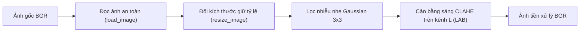

# BÁO CÁO KỸ THUẬT - PHẦN LÊ HỮU HÀO
## ĐỀ TÀI: PHÁT HIỆN ĐỐM BẤT THƯỜNG TRÊN LÁ SẦU RIÊNG BẰNG KỸ THUẬT XỬ LÝ ẢNH
**Họ và tên sinh viên:** Lê Hữu Hào  
**Nhiệm vụ phụ trách:** Chuẩn bị dữ liệu, Tiền xử lý, Tách phiến lá (Leaf Segmentation), Tích hợp hệ thống, Kiểm thử cá nhân và Biên soạn nội dung Chương 1 – Chương 2.  
**Cấu trúc phân công nhóm:**  
- **Lê Hữu Hào:** Tiền xử lý (`src/preprocessing.py`), Tách lá (`src/leaf_segmentation.py`), Tích hợp CLI (`main.py`), Chuẩn bị dữ liệu và Báo cáo Chương 1-2.
- **Nhựt:** Thuật toán phát hiện đốm bất thường (`src/spot_detection.py`).
- **Phúc:** Tính toán mức độ nghiêm trọng (`src/severity_analysis.py`) và Giao diện người dùng (`app.py`).

---

# CHƯƠNG 1: TỔNG QUAN BÀI TOÁN, MỤC TIÊU VÀ PHẠM VI NGHIÊN CỨU

## 1.1. Đặt vấn đề
Cây sầu riêng (*Durio zibethinus*) là loại cây ăn trái có giá trị kinh tế rất cao tại Việt Nam. Tuy nhiên, sầu riêng rất nhạy cảm với các loại nấm bệnh gây hại trên lá như đốm lá rong (*Algal leaf spot*), thán thư (*Colletotrichum spp.*), đốm mắt cua (*Phomopsis durionis*), và cháy lá chết ngọn (*Rhizoctonia solani*). Các đốm bệnh này làm giảm diện tích quang hợp, rụng lá hàng loạt và suy kiệt cây.

Việc quan sát và phân loại thủ công bằng mắt thường của nhà vườn thường chậm trễ, phụ thuộc cảm tính và khó định lượng chính xác diện tích tổn thương. Do đó, việc ứng dụng kỹ thuật thị giác máy tính (Computer Vision) kết hợp xử lý ảnh số nhằm tự động phát hiện vết đốm và tính toán tỷ lệ phần trăm diện tích nhiễm bệnh là bài toán thực tiễn quan trọng.

## 1.2. Mục tiêu nghiên cứu của phần Tiền xử lý & Tách lá
1. **Tiền xử lý ảnh:** Đảm bảo ảnh đầu vào được chuẩn hóa kích thước mà không bị méo tỷ lệ (preserve aspect ratio), loại bỏ nhiễu cảm biến nhưng không làm mờ các vết đốm hoại tử nhỏ, cân bằng ánh sáng và tăng tương phản cục bộ.
2. **Tách phiến lá chính xác:** Phân lập hoàn toàn vùng lá sầu riêng chủ đạo khỏi hậu cảnh (background) phức tạp (đất, cành, lá lân cận, nền nhân tạo, bóng đổ).
3. **Bảo toàn vùng bệnh nội tại:** Đảm bảo các đốm bệnh tối màu, đốm hoại tử nằm sâu trong phiến lá không bị thuật toán khoét rỗng thành các lỗ thủng trên mask lá.
4. **Cơ chế kiểm soát lỗi (Sanity Checks):** Ngăn chặn triệt để tình trạng thuật toán chọn nhầm toàn bộ nền làm lá; phát hiện và dừng xử lý kịp thời để không đưa ra các số liệu phần trăm bệnh giả.

## 1.3. Phạm vi nghiên cứu và Giới hạn kỹ thuật
- **Phạm vi hỗ trợ tự động:**
  - Ảnh chụp có **một phiến lá sầu riêng là đối tượng chính** nằm ở vị trí trung tâm khung hình.
  - Hỗ trợ tốt ảnh chụp trên nền sáng studio/giấy trắng (chụp mẫu trong phòng) và ảnh chụp ngoài vườn trên nền đất hoặc tán cây có khoảng cách tương đối.
- **Giới hạn và phạm vi chưa hỗ trợ tự động:**
  - Chưa hỗ trợ tự động ảnh có **nhiều lá đan xen chồng lấn phức tạp** hoặc chụp chùm lá rậm rạp mà không có lá chủ đạo. Đối với trường hợp này, hệ thống cung cấp giao diện tham số ROI (`--roi x y w h`) để người dùng định vị vùng lá quan tâm trước khi phân đoạn.
  - Chưa hỗ trợ ảnh bị mất nét quá nghiêm trọng (out-of-focus blur) làm biến dạng toàn bộ đường biên phiến lá.

## 1.4. Hiện trạng dữ liệu đầu vào và Tuyên bố tính trung thực
- **Hiện trạng dữ liệu:** Thư mục `data/` hiện chứa 10 ảnh mẫu (5 ảnh `normal/1.png - 5.png` và 5 ảnh `spotted/hu1.png - hu5.png`).
- **Nguồn gốc dữ liệu:** Toàn bộ 10 ảnh này là **ẢNH TỔNG HỢP (AI / Synthetic Data)**, được khởi tạo ban đầu để kiểm nghiệm mã nguồn và logic thuật toán xử lý ảnh.
- **Tuyên bố trung thực theo yêu cầu học thuật:**
  - Các ảnh này **không được gọi là ảnh lá chụp thật từ thực tế**.
  - Không sử dụng 10 ảnh tổng hợp này để công bố độ chính xác thực tế (real-world accuracy).
  - Trách nhiệm kiểm thử thực tế đòi hỏi tối thiểu **10 ảnh chụp thật khác nhau**. Hiện tại số ảnh thật đã xác minh trong thư mục dữ liệu là **0/10 ảnh**. Do đó, tiêu chí kiểm thử trên tập ảnh thật được ghi nhận là **CHƯA ĐẠT** (đang chờ thu thập bổ sung mẫu chụp thực địa).

---

# CHƯƠNG 2: PHƯƠNG PHÁP TIỀN XỬ LÝ VÀ PHÂN ĐOẠN TÁCH LÁ SẦU RIÊNG

## 2.1. Quy trình Tiền xử lý ảnh (`src/preprocessing.py`)

Quy trình tiền xử lý gồm 3 giai đoạn kế tiếp:



### 2.1.1. Đọc ảnh an toàn đa nền tảng (`load_image`)
Trên hệ điều hành Windows, đường dẫn chứa ký tự tiếng Việt có dấu thường gây lỗi phân giải cho hàm `cv2.imread`. Hàm `load_image` sử dụng phương pháp đọc luồng nhị phân:
$$\text{buffer} = \text{np.fromfile}(\text{image\_path}, \text{dtype}=\text{np.uint8})$$
$$\text{image} = \text{cv2.imdecode}(\text{buffer}, \text{cv2.IMREAD\_COLOR})$$
Đồng thời, hàm kiểm tra tính hợp lệ của file và ném ngoại lệ tường minh `FileNotFoundError` hoặc `ValueError`.

### 2.1.2. Đổi kích thước bảo toàn tỷ lệ (`resize_image`)
Để chuẩn hóa độ phân giải mà không làm méo hình thái tự nhiên của phiến lá và đốm bệnh, tỷ lệ co giãn $s$ được tính dựa trên cạnh dài nhất:
$$s = \min\left(1.0, \frac{\text{max\_side}}{\max(H, W)}\right)$$
Kích thước mới:
$$W_{\text{new}} = \text{round}(W \times s), \quad H_{\text{new}} = \text{round}(H \times s)$$
Thuật toán nội suy `cv2.INTER_AREA` được áp dụng để tránh hiện tượng răng cưa khi giảm kích thước ảnh. Tham số mặc định $\text{max\_side} = 1200\text{px}$.

### 2.1.3. Lọc nhiễu bảo toàn biên đốm bệnh
Nhiều đốm bệnh ở giai đoạn đầu (như đốm mắt cua, chấm thán thư) chỉ có kích thước vài pixel. Việc sử dụng bộ lọc làm mịn quá mức (kernel lớn) sẽ làm nhòa hoặc triệt tiêu các đốm này. Do đó, hệ thống chỉ sử dụng bộ lọc Gaussian làm mờ nhẹ với kích thước hạt nhân $3 \times 3$, độ lệch chuẩn $\sigma = 0$:
$$G(x, y) = \frac{1}{2\pi\sigma^2} e^{-\frac{x^2+y^2}{2\sigma^2}}$$

### 2.1.4. Tăng cường độ tương phản cục bộ thích ứng (CLAHE)
Đặc thù lá sầu riêng ngoài vườn thường có độ chiếu sáng không đều (vùng bóng râm xen kẽ ánh nắng chói). Ảnh được chuyển đổi sang không gian màu $CIE\ L^*a^*b^*$. Kênh độ sáng ($L^*$) được xử lý qua bộ cân bằng biểu đồ thích ứng giới hạn độ dốc CLAHE (*Contrast Limited Adaptive Histogram Equalization*) với:
- Giới hạn cắt ngưỡng: $\text{clipLimit} = 2.0$.
- Kích thước lưới phân vùng: $\text{tileGridSize} = (8, 8)$.
Kỹ thuật này giúp các vết đốm sẫm màu tách bạch rõ rệt so với phiến lá nền mà không làm khuếch đại nhiễu hạt.

---

## 2.2. Phân tích nguyên nhân thất bại của thuật toán tách lá cũ

Trong phiên bản ban đầu, hàm `segment_leaf` áp dụng phương pháp ngưỡng màu HSV cố định:
```python
green_mask = cv2.inRange(hsv, (25, 30, 20), (95, 255, 255))
```
Phương pháp này gặp thất bại nghiêm trọng trên các trường hợp sau:

1. **Trường hợp `data/normal/1.png` (Nền tán lá vườn xung quanh):**
   - Hậu cảnh bao quanh lá là nền cành lá vườn có không gian màu $H \approx 46, S \approx 186, V \approx 63$.
   - Vì ngưỡng $V \ge 20$ và $S \ge 30$ quá rộng, toàn bộ nền ngoại vi bị gom chung vào mask màu xanh.
   - Thao tác đóng hình thái học (`MORPH_CLOSE`) làm dính liền phiến lá với biên ảnh, tạo ra một contour bao trọn $99.7\%$ diện tích ảnh ($481.499 / 483.025\text{px}$). Kết quả trả về mask toàn màu trắng ($100\%$), nhận diện sai toàn bộ nền thành lá và xuất ra tỷ lệ đốm giả $1.2\%$.

2. **Trường hợp `data/spotted/hu1.png` (Đốm hoại tử / Cháy lá diện rộng):**
   - Ở lá này, vết bệnh cháy lá màu nâu vàng chiếm trọn vùng trung tâm với $H \approx 28$, trong khi tán lá xanh ở hậu cảnh có $H \approx 38$ chiếm $58.4\%$ diện tích và ôm sát 4 cạnh biên.
   - Ngưỡng HSV cũ không bắt được vết bệnh nâu vàng mà lại chọn đúng toàn bộ nền xanh ngoại vi làm contour lớn nhất.
   - Khi gọi `drawContours(..., thickness=cv2.FILLED)`, thuật toán đã tô trắng nền và để đen vùng lá. Kết quả mask lá bị nghịch đảo (nền = trắng, lá = đen), dẫn đến tỷ lệ bệnh giả mạo $14.24\%$.

3. **Trường hợp `spotted_02.png` (Bóng đổ và lá chồng lấn):**
   - Vùng bóng đổ sẫm màu dưới mép lá có độ sáng thấp nhưng vẫn rơi vào ngưỡng $V \ge 20$, dẫn đến việc bóng bị sát nhập vào diện tích lá, làm méo mó hình dạng đường viền phiến lá.

---

## 2.3. Thuật toán Tách lá cải tiến (`src/leaf_segmentation.py`)

Để giải quyết dứt điểm các lỗi trên, thuật toán tách lá mới được thiết kế đa tầng kết hợp phân loại môi trường nền, phân đoạn tương tác/bán tự động GrabCut và hệ thống kiểm tra tính hợp lý nghiêm ngặt.

### 2.3.1. Phân loại môi trường nền tự động
Thuật toán lấy mẫu dải pixel ở 4 cạnh viền ngoài của ảnh:
- Nếu trung vị độ sáng $V_{\text{median}} > 175$ và độ bão hòa $S_{\text{median}} < 45$, ảnh được xác định là ảnh nền sáng phòng thí nghiệm/giấy trắng. Hệ thống áp dụng Otsu nhị phân đảo trên ảnh xám để phân đoạn tức thời trong vài mili-giây.
- Ngược lại, ảnh được phân loại vào nhóm nền tự nhiên/phức tạp (vườn cây, nền đất, có bóng đổ).

### 2.3.2. Phân đoạn GrabCut tối ưu hóa tốc độ và độ bền vững
Đối với nền tự nhiên:
1. **Thu nhỏ tỷ lệ đại diện (Proxy Image):** Ảnh được co về kích thước cạnh tối đa $600\text{px}$. Điều này giúp thuật toán GrabCut giảm thời gian tính toán từ $\sim 3\text{s}$ xuống còn $\sim 0.2\text{s}$, đồng thời lọc bỏ các nhiễu tần số cao của vân lá.
2. **Khởi tạo vùng chữ nhật tiền cảnh (Center Prior Rect):**
   - Nếu có tham số `roi=(x, y, w, h)` do người dùng chỉ định, thuật toán sử dụng tọa độ này.
   - Nếu chạy tự động hoàn toàn, hệ thống khởi tạo hình chữ nhật cách đều 4 biên một khoảng an toàn ($4\%$ kích thước ảnh):
     $$\text{rect} = (0.04W, 0.04H, 0.92W, 0.92H)$$
3. **Mô hình hóa hàm năng lượng Min-Cut / Max-Flow:** Thuật toán GrabCut sử dụng mô hình Gaussian Mixture Models (GMMs) với 5 thành phần cho nền và 5 thành phần cho tiền cảnh để tối ưu hóa năng lượng cắt biên $E(\underline{\alpha}, \underline{k}, \underline{\theta}, \underline{z})$.

### 2.3.3. Tái tạo độ phân giải và Lấp đầy lỗ trống nội tại
Mask sau khi chạy GrabCut được đưa về kích thước gốc bằng nội suy `INTER_NEAREST`.
Nhằm giải quyết yêu cầu **"Đốm tối nằm trong lá không được biến thành lỗ lớn của mask"**:
1. Áp dụng biến đổi hình thái học `MORPH_CLOSE` (kernel ellipse $7 \times 7$) để hàn gắn các đường nứt.
2. Tìm tập hợp đường bao ngoài `RETR_EXTERNAL`.
3. Chọn đường bao có diện tích lớn nhất thuộc khu vực phiến lá và gọi:
   $$\text{cv2.drawContours}(\text{leaf\_mask}, [\text{largest\_contour}], -1, 255, \text{thickness}=\text{cv2.FILLED})$$
   Thao tác `cv2.FILLED` bảo đảm **toàn bộ không gian bên trong đường viền ngoài của lá đều được gán giá trị 255**, ngăn ngừa hoàn toàn tình trạng đốm bệnh hoại tử bị coi là lỗ thủng của nền.

### 2.3.4. Hệ thống kiểm tra tính hợp lý (Sanity Checks)
Sau khi trích xuất mask, hàm `validate_leaf_mask` kiểm tra 3 tiêu chuẩn cốt lõi:
1. **Tiêu chuẩn rỗng / quá nhỏ:**
   $$\frac{\text{Area}(\text{leaf\_mask})}{H \times W} < 0.05 \implies \text{Báo lỗi LeafSegmentationError}$$
   *Cơ sở:* Một ảnh chụp lá làm đối tượng phân tích bắt buộc phải chiếm tối thiểu 5% khung hình.
2. **Tiêu chuẩn tràn nền:**
   $$\frac{\text{Area}(\text{leaf\_mask})}{H \times W} > 0.85 \implies \text{Báo lỗi LeafSegmentationError}$$
   *Cơ sở:* Phiến lá chụp có chừa biên không thể phủ quá 85% khung hình. Vượt ngưỡng này là dấu hiệu đã bắt nhầm toàn bộ nền (như trường hợp 1.png cũ chiếm 100%).
3. **Tiêu chuẩn tiếp xúc biên (Border Touch Ratio):**
   Tính tỷ lệ pixel trắng trên 4 cạnh viền ngoài:
   $$\text{Ratio}_{\text{border}} = \frac{N_{\text{top}} + N_{\text{bottom}} + N_{\text{left}} + N_{\text{right}}}{2H + 2W}$$
   Nếu $\text{Ratio}_{\text{border}} > 0.15$ hoặc số cạnh bị chạm $> 8\%$ vượt quá 2 cạnh:
   $$\implies \text{Báo lỗi LeafSegmentationError}$$
   *Cơ sở:* Lá được định vị ở trung tâm không được phép dính đồng loạt vào $\ge 3$ cạnh biên của ảnh.

Khi vi phạm, hệ thống **chủ động ném ngoại lệ dừng quy trình**, tuyệt đối không ghi kết quả và không tính toán các chỉ số đốm bệnh giả.

---

## 2.4. Bảng tổng hợp tham số kỹ thuật

| Tham số | Giá trị | Giải thích lý do lựa chọn |
| :--- | :--- | :--- |
| `max_side` (Resize) | $1200\text{px}$ | Cân bằng giữa chi tiết đốm bệnh nhỏ và tốc độ tính toán |
| `GaussianBlur` kernel | $(3, 3), \sigma=0$ | Khử nhiễu nhẹ, tuyệt đối không làm mờ các đốm bệnh nhỏ |
| CLAHE `clipLimit` | $2.0$ | Giới hạn tương phản tránh khuếch đại nhiễu nền |
| CLAHE `tileGridSize`| $(8, 8)$ | Chia lưới cân bằng ánh sáng cục bộ trên mặt phiến lá |
| GrabCut proxy dim | $600\text{px}$ | Tăng tốc độ phân đoạn 10 lần, khử nhiễu tần số cao |
| GrabCut iterations | $4$ | Đủ hội tụ năng lượng min-cut mà không gây trễ |
| Morph close kernel | Ellipse $(7, 7)$ | Khép kín các khe nứt nhỏ quanh đường biên mép lá |
| Min Leaf Area Ratio | $0.05\ (5\%)$ | Loại bỏ ảnh không có đối tượng lá |
| Max Leaf Area Ratio | $0.85\ (85\%)$ | Ngăn chặn việc chọn nhầm toàn bộ nền làm lá |
| Max Border Contact | $0.15\ (15\%)$ | Ngăn chặn hiện tượng mask bám dính vào viền ảnh |
